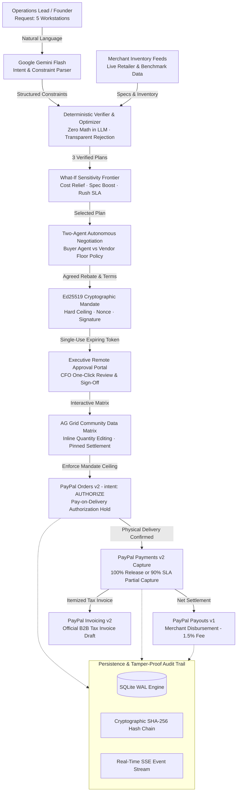

# ProcureAI: Autonomous AI Hardware Procurement Agent
### Powered by PayPal Pay-on-Delivery Authorization Holds & Ed25519 Spending Mandates

[](https://paypalaihackathon.devpost.com/)
[](test/)
[](https://developer.paypal.com/)
[](https://ai.google.dev/)
[](https://www.ag-grid.com/)
[](LICENSE)
[](docs/DEPLOY.md)

> [!NOTE]
> **ProcureAI** is an autonomous AI procurement agent that negotiates and purchases workstation hardware on your behalf under an **Ed25519 cryptographic spending mandate**. PayPal holds buyer funds in a **pay-on-delivery authorization hold** until goods are delivered and verified—eliminating upfront payment risk.

---

## 🌐 Live Demo & Deployment

* **Live Public URL:** See [`docs/LIVE_URL.txt`](docs/LIVE_URL.txt) for the current live deployment link.
* **One-Click Deploy:** Deploy your own live instance on Render using the Blueprint in [`render.yaml`](render.yaml). Full instructions in [`docs/DEPLOY.md`](docs/DEPLOY.md).

### How Render is Used
1. **Web Service (Starter, Region Singapore):** Hosts the unified Express server and React single-page application on Node.js 24 with zero cold-start delay.
2. **Persistent Disk (1 GB at `/var/data`):** Mounts persistent storage for the native `node:sqlite` database, preserving orders, cryptographic mandates, and SHA-256 hash-chained audit logs across code deploys and server restarts.
3. **Health Checks (`/api/health`):** Automated probes monitor database persistence, FX rate freshness, and integration readiness without exposing credentials.
4. **Infrastructure-as-Code:** Defined via `render.yaml` (Starter + persistent disk) with a documented `render.free.yaml` fallback.

---

## 1. Real-World Problem & Target Audience

### The Target Audience
Startups (5–50 employees), engineering teams, creative studios, and SMBs procuring commercial IT hardware in bulk.

### The Problem
Equipping a team with workstations (monitors, laptops, mechanical keyboards, audio) currently suffers from:
* **Fragmented Vendor Chaos:** Tedious negotiations across WhatsApp, spreadsheets, and unverified vendor proformas.
* **100% Upfront Capital Risk:** Merchants require 100% upfront wire transfers before dispatch.
* **Zero Leverage on Failure:** When components arrive defective, delayed by weeks, or missing specs (e.g., 75Hz panels instead of requested 144Hz), buyers have zero financial recourse.
* **Lack of Spending Governance:** Employees and procurement leads lack cryptographic spending limits and tamper-proof audit trails.

### The Solution: ProcureAI
1. **Natural Language Intake:** Specify workstation requirements in plain English; Gemini extracts quantities and hardware constraints.
2. **Deterministic Optimizer:** Zero math in the LLM. Algorithms check compatibility, stock, and delivery deadlines across the catalog.
3. **What-If Sensitivity Frontier:** Real-time trade-offs (Cost Relief, Hardware Boost, Express Speed) with itemized change confirmation.
4. **Autonomous Vendor Negotiation:** Multi-round agentic negotiation defending private vendor reservation floors.
5. **Ed25519 Cryptographic Spending Mandate:** Generates tamper-proof mathematical envelopes with single-use expiring CFO approval tokens.
6. **PayPal Pay-on-Delivery Authorization Hold:** Funds remain in an authorization hold (`intent: "AUTHORIZE"`) and are captured only upon physical delivery inspection.

---

## 2. End-to-End System Architecture



---

## 3. Four-Step Agentic Commerce Lifecycle

```
[ Step 0: Brief & Clarification ] ──▶ [ Step 1: Verified Plans & Matrix ] ──▶ [ Step 2: Mandate & Hold ] ──▶ [ Step 3: Delivery Settle ]
```

### Step 0: Natural Language Intake & Clarification Guardrails
* **Context Extraction:** Translates requests like *"5 workstations under ₹3 lakh with 144Hz monitors"* into structured category requirements.
* **Clarification Engine:** If critical details (such as budget cap or quantities) are omitted, the agent pauses and prompts targeted clarification questions rather than guessing or hallucinating defaults.

### Step 1: Deterministic Plan Optimization & Sensitivity Frontier
* **Tri-Plan Synthesis:**
  * **Plan A (Cheapest):** Minimum cost basket meeting every hard constraint.
  * **Plan B (Best Value):** Optimal weighted quality, warranty, and delivery score within budget.
  * **Plan C (Alternative):** Max performance tier diversifying component brands.
* **Interactive AG Grid Matrix:** Edit quantities, test price changes, and swap items in real time with pinned settlement totals.
* **Over-Budget Guardrail & Auto-Rebalance:** If customizations exceed budget, the mandate lock is disabled and an autonomous algorithm downgrades non-essential components to restore compliance with transparency reports.
* **What-If Sensitivity Frontier:** Recommends actionable parameter trade-offs:
  * *Cost Relief (+2 Days):* Unlocks standard freight, saving up to ₹30,000+.
  * *Hardware Boost (+₹10k):* Unlocks tier-1 components (165Hz IPS panels, hot-swap keyboards).
  * *Express Priority (3 Days):* Prioritizes immediate-dispatch air freight.
* **Itemized Confirmation Modal:** Transparently breaks down before-and-after component changes, unit prices, and net differences before applying. A **Reset to Default** button reverts constraints anytime.

### Step 2: Spending Mandate & Executive Approval Portal
* **Ed25519 Spending Mandate:** Asymmetrically signed spending envelope binding budget ceiling (`maxTotalINR`, `maxTotalUSD`), merchant IDs, and expiration timestamp.
* **Single-Use Expiring Tokens:** Generates time-limited CFO approval links. Replay attacks and parameter tampering are rejected instantly.

### Step 3: PayPal Authorization Hold & Delivery Settle
* **Authorization Hold Placed:** Calls PayPal Orders v2 with `intent: "AUTHORIZE"`. Funds are held on authorization hold without leaving the buyer's account.
* **Physical Inspection Sign-Off:** When delivery arrives intact, buyer confirms release to capture payment (`POST /v2/payments/authorizations/:id/capture`).
* **Atomic SLA Penalty Capture:** If delivery slips past agreed horizon, captures 90% and automatically voids 10% penalty credit in a single atomic transaction.

---

## 4. PayPal Platform Implementation

ProcureAI exercises official PayPal Sandbox APIs across the entire procurement lifecycle:

| PayPal API / Feature | Endpoint | Business Purpose |
|---|---|---|
| **Orders v2 (Authorize Intent)** | `POST /v2/checkout/orders` (`intent: "AUTHORIZE"`) | Holds buyer funds in a pay-on-delivery authorization hold instead of capturing immediately. |
| **Orders v2 (Authorize Call)** | `POST /v2/checkout/orders/:id/authorize` | Authorizes the held amount after buyer approval, establishing an authorization window with unique PayPal `authorization_id`. |
| **Payments v2 (Capture)** | `POST /v2/payments/authorizations/:id/capture` | Captures held funds atomically upon physical delivery inspection confirmation. |
| **Atomic SLA Penalty Capture** | `POST /v2/payments/authorizations/:id/capture` (`final_capture: true`) | On delivery delay, captures 90% and automatically voids the 10% penalty credit in one call. |
| **Payments v2 (Void)** | `POST /v2/payments/authorizations/:id/void` | Immediately voids authorization and unfreezes buyer funds if order is cancelled or mandate fails. |
| **Invoicing v2** | `POST /v2/invoicing/invoices` | Automatically generates an official itemized B2B tax invoice draft with line items, tax, and currency metadata. |
| **Payouts v1** | `POST /v1/payments/payouts` | Disburses merchant settlement minus platform fee (gracefully handled via simulation fallback in regions where Payouts API is restricted). |
| **Currency Reconciliation** | `reconcileItemizedTotal()` | Resolves fractional cent rounding differences when converting INR to USD, preventing `ITEM_TOTAL_MISMATCH` errors. |

---

## 5. AI Engineering & Zero-Math Principles

> [!IMPORTANT]
> **No LLM Math:** Large Language Models are non-deterministic and prone to calculation errors. ProcureAI delegates semantic parsing and multi-turn negotiation to AI, while all financial arithmetic and inequality constraints are executed by pure deterministic code.

* **Intent & Constraint Extraction:** Google Gemini Flash parses unstructured natural language and maps requirements to strict numeric attributes.
* **Two-Agent Autonomous Negotiation:** Buyer LLM negotiates volume discounts against an autonomous vendor agent defending private mathematical reservation price floors (`calculateVendorFloor`).
* **Prompt Injection Defense:** Multi-layered input sanitizer rejects adversarial prompts attempting to bypass spending limits or waive authorization protections.
* **Offline Simulation Mode:** If network or API limits occur, negotiations gracefully transition to an offline simulation engine clearly labeled for audit integrity.

---

## 6. Run Locally (Zero Keys Required)

You can run ProcureAI locally without any external API keys. When live PayPal or Gemini credentials are omitted, ProcureAI operates in local deterministic heuristic mode with a labeled evaluation simulator.

### Prerequisites
* **Node.js >= 22.13.0** or **24.x** (required for unflagged native `node:sqlite`)
* Modern web browser

```bash
# 1. Clone repository & install dependencies
git clone https://github.com/Varshith226/ProcureAI-Paypal.git
cd ProcureAI-Paypal
npm install
npm install --prefix client

# 2. Configure environment (Optional: add live PayPal or Gemini keys)
cp .env.example .env

# 3. Build frontend assets
npm run build --prefix client

# 4. Start the application
npm start
```
Open **`http://localhost:3000`** in your browser.

---

## 7. Automated Test Suite (216 Passing Tests)

Run the comprehensive test suite:
```bash
npm test
```

```
✔ 216 passing tests across unit, integration, and security suites (0 failures)
✔ Full Playwright E2E browser verification across mobile (390x844) and desktop (1440x900)
```

### Key Test Suites:
* **`test/endToEndHardening.test.js`:** SQL injection defense, price spike revalidation, quota calculations, and mandate tampering refusal.
* **`test/approvalTokens.test.js`:** Single-use approval tokens, token consumption, replay attack defense, and expiration enforcement.
* **`test/paypalHardening.test.js`:** Authorize-then-capture lifecycle, atomic 90% SLA penalty capture, and void flows.
* **`test/promptInjectionSecurity.test.js`:** Adversarial prompt injection defense, budget bypass prevention, and negative price rejection.
* **`test/auditLogResilience.test.js`:** SQLite SHA-256 hash-chained audit trail integrity verification.
* **`scripts/test-clarification-and-aggrid.js`:** Automated Playwright browser test verifying clarification, AG Grid rendering, auto-rebalance, What-If Frontier confirmation, and PayPal capture.

---

## 8. Technology Stack

* **Frontend:** React 18, Vite, Ant Design 5 (Cyberpunk Dark Glassmorphic Theme), AG Grid Community v36, Three.js (Dynamic Aurora Vault Canvas), Framer Motion.
* **Backend:** Node.js (Express 5), SQLite WAL (`node:sqlite`), Server-Sent Events (SSE), Ed25519 Cryptography (`node:crypto`).
* **Payments & Settlement:** PayPal Orders v2, Payments v2, Invoicing v2, Payouts v1 Sandbox APIs.
* **AI & NLP:** Google Gemini Flash (`@google/genai`), Multi-Agent Negotiation Protocol.
* **Testing & Quality:** Node Test Runner (`node --test`), Playwright Headless Browser Automation.

---

## 9. License

This project is licensed under the **MIT License** — see the [LICENSE](LICENSE) file for details.
